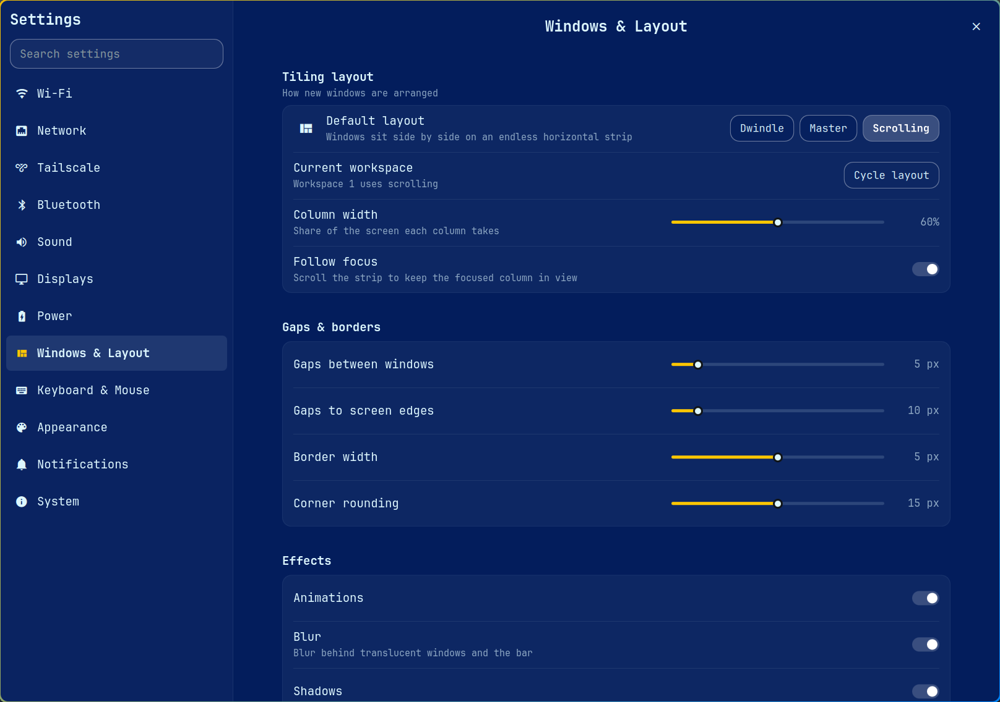
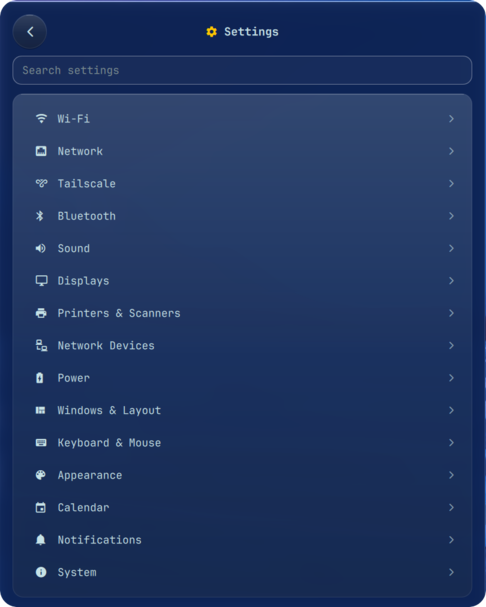

# Control Center for Omarchy

**Every setting you reach for, one click from the bar.**

Control Center gives [Omarchy](https://omarchy.org) Quattro a polished, GNOME- and macOS-style **Quick Settings** panel: live status icons in the bar, glassy toggles and sliders, a Now Playing card, today's next meeting, a real notification center, and a complete settings app that opens *inside* the panel. It's built as a native Omarchy shell (Quickshell) plugin, so it follows your theme, updates the instant something changes, and drives Omarchy's own commands under the hood.



<p align="center"></p>

## Highlights

- **A bar that tells you things.** Wi-Fi turns green with live signal bars, Bluetooth turns blue when something is connected, Tailscale shows its own nine-dot mark (dim when disconnected), the speaker has a tiny volume meter, and the battery shows its level, a charging bolt when plugged in, and turns orange at 20% and red at 10%. An orange camera or microphone appears while any app is using them, and hovering tells you which.
- **Quick Settings that fit on screen.** Eight big tiles (Wi-Fi, Bluetooth, Sound, Tailscale, Power Mode, Displays, Night Light, Do Not Disturb), a row of small round toggles (Stay Awake, Airplane, Screen Record, Reminders, VPN, Firewall, Wallpaper, Passwordless Sudo, battery charge limit), and sliders for volume, microphone, screen brightness and keyboard backlight.
- **Menus that slide in, not pile up.** A tile's arrow swaps the panel for its menu, like macOS Control Center: networks with inline passwords, Bluetooth devices with battery levels, Tailscale exit nodes, sound devices and per-app volume, Night Light schedule and warmth, and more. Back (or `Esc`) slides you out again.
- **Now Playing.** Album art, title, a seekable progress bar and transport controls for any MPRIS player, with a switcher when several are running. *Previous* restarts the song the way you expect, and the card lingers for 30 seconds after you pause so you can pick up where you left off.
- **Today at a glance.** Your next event from any iCal calendar, with a **Join** button 15 minutes before a Meet, Zoom or Teams call, plus a month-view Calendar page and meeting reminders.
- **A real notification center** (optional): pop-ups with action buttons and inline replies, Do Not Disturb that also lights Omarchy's bar indicator, and a history that survives shell restarts.
- **A full settings app in the panel:** Wi-Fi, Network, Tailscale, Bluetooth, Sound, Displays, Printers & Scanners, Firewall, Network Devices, Power, Windows & Layout, Keyboard & Mouse, Appearance, Calendar, Notifications and System, with search.
- **Firewall without the terminal.** Turn ufw on or off, choose what happens to unexpected connections, see every rule in plain words ("Port 8080 TCP · from 192.168.1.0/24"), remove one, or open a port for your local network or the internet.
- **Wallpaper at a click.** Next wallpaper from Quick Settings, or pick one from thumbnails of the current theme's backgrounds and your own.
- **Import a VPN.** Drop in a WireGuard `.conf` or OpenVPN `.ovpn` file from your provider; Control Center finds it in Downloads, Documents or your home folder and adds it to NetworkManager.
- **Every display, its own way.** Resolution, scale, rotation, adaptive sync (VRR), 10-bit colour, colour mode (sRGB, wide gamut, HDR) and HDR brightness per monitor, remembered per monitor whichever port it's plugged into, with a 15-second "Keep changes?" safety net.
- **Glass and motion.** Soft highlights, raised knobs, glossy check badges and short slide transitions, in your theme's colours.
- **Keyboard-first.** Arrows or `h j k l` move, `Tab` walks everything, `Enter` activates, `←`/`→` adjust sliders, `Esc` steps back.

## Install

```bash
omarchy plugin add https://github.com/bahman777/omarchy-control-center --enable
omarchy restart shell
```

The status icons appear on the right of the bar. Click them for Quick Settings; right-click for the settings index. Since the cluster covers network, Bluetooth, audio and battery, you may want to remove Omarchy's own indicators from the bar (`omarchy bar`).

## Remove

```bash
omarchy plugin remove io.github.bahman777.control-center
omarchy restart shell
```

Then, only if you used these opt-in features:

- **Notification center:** turn it off first (Notifications page) and the plugin hands notifications back to Omarchy. If you removed the plugin while it was on, re-enable Omarchy's service with `omarchy plugin enable omarchy.notifications`.
- **"Keep after restart" for window settings:** delete the `pcall(dofile, … control-center.lua)` line at the end of `~/.config/hypr/hyprland.lua` and the file `~/.config/hypr/control-center.lua`. A backup from before the line was added is at `~/.config/hypr/hyprland.lua.bak.control-center`.
- **Night Light schedule:** your original `~/.config/hypr/hyprsunset.conf` is kept as `hyprsunset.conf.before-control-center`; copy it back.
- Optional cleanup: `~/.local/state/omarchy/control-center/` (settings, notification history, calendar links) and `~/.cache/omarchy-control-center/`.

## Using it

| | |
|---|---|
| **Super + Ctrl + ,** | Open or close Quick Settings |
| **Super + Shift + Alt + ,** | Open the notification list |
| **Super + ,** / **Super + Alt + ,** | Act on / dismiss the newest pop-up |
| **Super + Shift + ,** | Clear all notifications |
| **Super + Ctrl + Alt + ,** | Toggle Do Not Disturb |

These are Omarchy's own notification bindings; the plugin answers them, so nothing in your keybindings changes. From scripts:

```bash
omarchy-shell control-center toggle            # open / close
omarchy-shell control-center menu sound        # open on a menu: wifi, bluetooth, tailscale, vpn, power,
                                               # sound, display, night, record, reminders, sudo,
                                               # outputs, inputs, session
omarchy-shell control-center settings displays # open on a settings page (or 'index')
```

### A few details worth knowing

- **Sound output switching** moves everything that's playing to the new device, including players that don't announce an app name (Mopidy, for one). When another device is still playing besides the one you selected, for example your laptop speakers as part of a Snapcast group, an extra "Also playing on…" slider appears for it.
- **Battery charge limit** (laptops that support it): the chip shows your limit, such as "Limit 80%". Click it to charge to 100% before a trip, then click again to go back. It uses `asusctl` on ASUS laptops (no password), otherwise the standard `charge_control_end_threshold` setting through a password prompt.
- **Keyboard backlight** works with any `*kbd_backlight*` device, through `brightnessctl`.
- **Night Light**: on/off, a schedule (sunset to sunrise, custom hours, or none), warmth and brightness. Sunset times come from a `lat lon` file at `~/tmp/latlon.txt` or `/tmp/latlon.txt` if you have one, otherwise from your time zone.
- **Battery alerts** for the laptop (20%, 10%, 5%) and every other device: Bluetooth headsets and mice, phones, and Logitech devices through Solaar (15%, 5%).
- **Calendars** are iCal links (for Google: Calendar settings → your calendar → Integrate calendar → "Secret address in iCal format"), stored privately (mode 600) and cached so events show offline.

## What it changes on your system

The plugin is careful about your configuration:

- **It never edits your own config without asking.** Window and input changes apply live with `hyprctl` and are saved to a file the plugin owns (`~/.config/hypr/control-center.lua`); they only load at login after you press **Keep after restart**, which adds one line to `hyprland.lua` after making a backup. Only an allowlist of Hyprland options is ever written, type-checked and clamped.
- **Notifications are opt-in.** Turning the notification center on disables Omarchy's notification service; turning it off restores it.
- **Night Light** writes `~/.config/hypr/hyprsunset.conf` only when you change its schedule, keeping your original.
- **Idle timers** go to the `idle` section of `~/.config/omarchy/shell.json`.
- Wherever Omarchy has a command (`omarchy-bluetooth-power`, `omarchy-powerprofiles-set`, `omarchy-dns`, `omarchy-theme-set`, …) the plugin uses it, so it behaves exactly like Omarchy's own menus.
- Actions that need administrator rights (DNS, time zone, adding printers, firewall changes, the generic charge limit) go through Omarchy's polkit password prompt. Reading the firewall's state and rules needs no password. **Passwordless Sudo** uses Omarchy's own `omarchy-sudo-passwordless`, with its confirmation, and can be turned off from the panel.
- The plugin makes **no network requests of its own** apart from fetching the iCal calendar links you add; the Wi-Fi speed test runs Omarchy's own `omarchy-network-speedtest`, and only when you start it. Commands run with argument lists, never shell strings built from data.

## Requirements

- Omarchy Quattro (4.x) with the Omarchy shell
- Ships with Omarchy: NetworkManager, PipeWire (`pactl`, `wpctl`), BlueZ, UPower, `brightnessctl`, `power-profiles-daemon`, `wl-clipboard`, `python3`
- Optional:
  - `tailscale` for the Tailscale tile and page
  - `python-icalendar` and `python-recurring-ical-events` for calendars
  - `solaar` for Logitech Unifying/Bolt battery levels
  - CUPS (`lpstat`, `system-config-printer`), SANE (`scanimage`) and `simple-scan` for printers and scanners
  - `asusctl` for the password-free charge limit on ASUS laptops
  - `ufw` for the firewall (the Firewall page offers to install it)
  - `networkmanager-openvpn` to import OpenVPN files (WireGuard needs nothing extra; the page offers to install it)

Anything that isn't installed or isn't present on your hardware simply doesn't appear: no keyboard backlight means no slider, no VPN means no VPN toggle, and so on.

<p align="center"><br></p>

## Development

The shell caches compiled QML, so run `omarchy restart shell` after changing files. `omarchy plugin validate .` checks the manifest.

```
manifest.json      plugin manifest (bar widget + notification service)
BarWidget.qml      bar status icons and the Quick Settings panel
NotifyService.qml  notification daemon, battery alerts, calendar reminders
quick/             Quick Settings: tiles, chips, sliders, menus, Now Playing, glass
pages/             one file per settings page
ui/                shared rows, groups and controls for the pages
tools/             helpers (audio output switch, privacy check, Night Light, calendar)
Pages.js           the settings page list
Runner.qml         argv-only process runner
HyprOptions.qml    live Hyprland options and persistence
HyprSpec.js        option allowlist, validation, Lua serialisation
Icons.js           Nerd Font glyphs
```

## License

[MIT](LICENSE)
